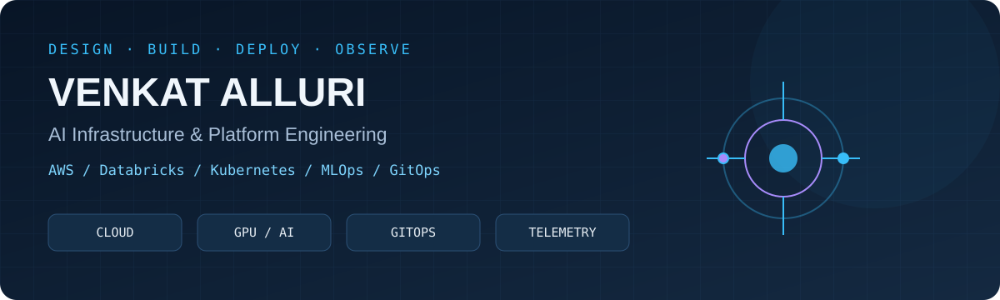
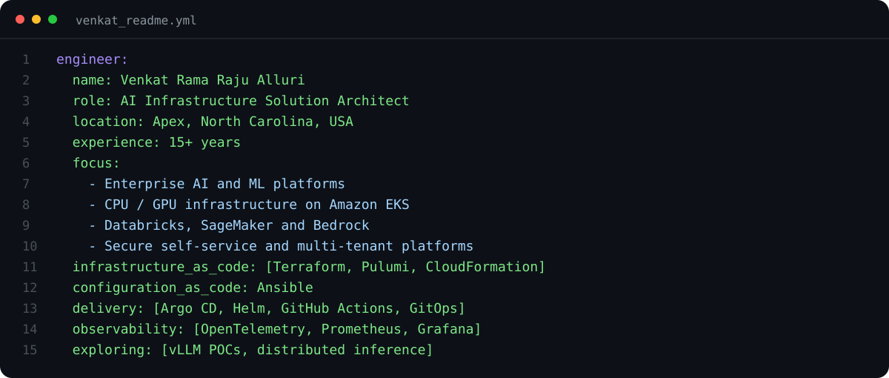
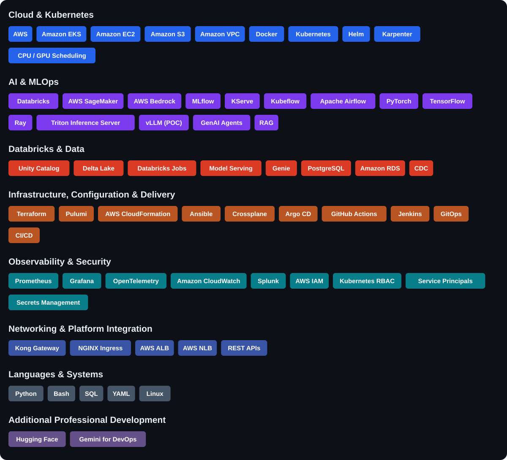
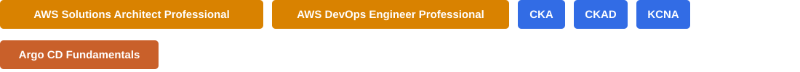

<h1 align="center">Hi! I'm Venkat Rama Raju Alluri</h1>
<h3 align="center">AI Infrastructure Solution Architect | MLOps | Cloud Platform Engineering</h3>

<h2 align="center">👨‍💻 About Me</h2>

I design and build **AI platforms that engineering and data science teams can operate in production**. My work connects cloud infrastructure, model lifecycle management, secure deployment, and reliable operations.

- 🏗️ **Current role:** AI Infrastructure Solution Architect at **Tiger Analytics**.
- ☁️ **AI platforms:** Databricks, AWS SageMaker, and AWS Bedrock — from platform foundations to governed deployment.
- ☸️ **Kubernetes:** Amazon EKS, shared CPU/GPU clusters, workload scheduling, model serving, and multi-region resilience.
- 🤖 **MLOps:** MLflow, KServe, Kubeflow, and Airflow for experimentation, orchestration, and inference.
- ⚙️ **Automation:** Terraform, Pulumi, CloudFormation, Ansible, Crossplane, and reusable Python platform services.
- 🔄 **Delivery:** Argo CD, Helm, GitHub Actions, Jenkins, and GitOps promotion workflows.
- 📊 **Operations:** OpenTelemetry, Prometheus, Grafana, CloudWatch, and Splunk.
- 🐧 **Linux:** Extensive administration and production operations across DevOps and MLOps environments.
- ✍️ **Writing:** Sharing practical cloud, DevOps, and MLOps experience on [Medium](https://medium.com/@allurivenkatramaraju).
- 🔬 **Exploring:** vLLM through proof-of-concept work and distributed inference patterns.

<a href="https://www.linkedin.com/in/venkatramarajualluri/">LinkedIn</a> ·
<a href="https://medium.com/@allurivenkatramaraju">Medium</a> ·
<a href="https://www.youtube.com/@allurivenkatramaraju">YouTube</a> ·
<a href="https://www.instagram.com/allurivenkatramaraju/">Instagram</a>

---

<h2 align="center">🚀 Languages · Platforms · Tools</h2>

**AI platform practices:** GenAI agents, RAG, experiment tracking, model registry, training, evaluation, deployment, monitoring, and CPU/GPU workload scheduling.

**Automation & governance:** Infrastructure as Code, Configuration as Code, GitOps, CI/CD, service principals, secrets management, environment isolation, and CDC.

**Professional development:** Hugging Face and Gemini for DevOps. **vLLM experience is at POC level.**

---

<h2 align="center">🛠️ Featured Repositories</h2>

| ☁️ AI Platform on AWS EKS | 🔄 GitOps Learning |
| --- | --- |
| [**aws-eks-ai-platform →**](https://github.com/alluri-venkatramaraju/aws-eks-ai-platform) | [**cgoa-exam-prep →**](https://github.com/alluri-venkatramaraju/cgoa-exam-prep) |
| Implementation-oriented reference architecture for secure, observable inference and batch training. Terraform, Argo CD, Karpenter, EKS Pod Identity, CPU/GPU examples, and operational documentation. | GitOps concepts, reconciliation patterns, Argo CD exercises, Kubernetes manifests, and mock exams for Certified GitOps Associate preparation. |
| **AWS · EKS · Terraform · GitOps · Observability** | **GitOps · Argo CD · Kubernetes · Hands-on labs** |

**Workshops and learning repositories**

| Repository | Focus |
| --- | --- |
| [APIOps Lab](https://github.com/alluri-venkatramaraju/apiops-lab) | Kong workshop template for OpenAPI-driven configuration, decK validation, and API delivery workflows. |
| [GitOps Certification Examples](https://github.com/alluri-venkatramaraju/gitops-certification-examples) | Codefresh workshop examples for Argo CD and GitOps learning. |

[**Explore all public repositories →**](https://github.com/alluri-venkatramaraju?tab=repositories)

---

<h2 align="center">🎓 Certifications</h2>

Additional professional development includes **Kong Gateway Foundations**, **MLOps with Databricks**, **MLflow and Hugging Face**, and **AI agent governance**.

---

<h2 align="center">📊 GitHub Stats & Activity</h2>

📈 More GitHub activity

---

<h2 align="center">🤝 Let's Connect</h2>

Interested in <b>AI infrastructure, MLOps, GPU platforms, Databricks, AWS, or Kubernetes?</b> Let's discuss architecture, production operations, and practical platform engineering.

<i>Build repeatable platforms. Make production observable. Give teams room to ship.</i>

<a href="#top">Back to top ↑</a>

